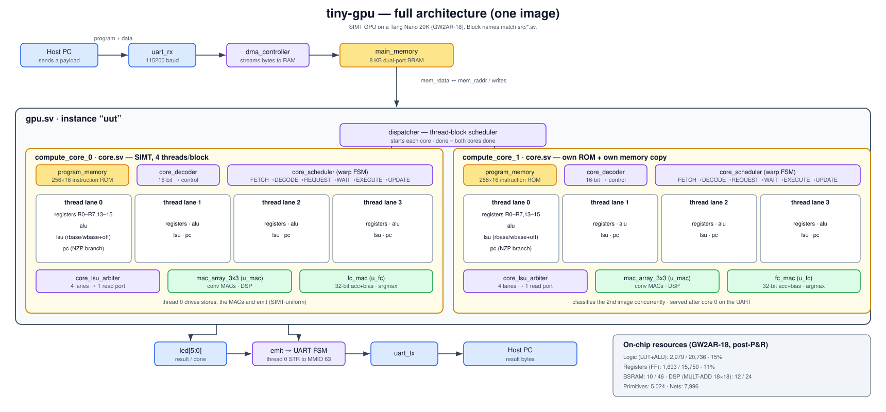
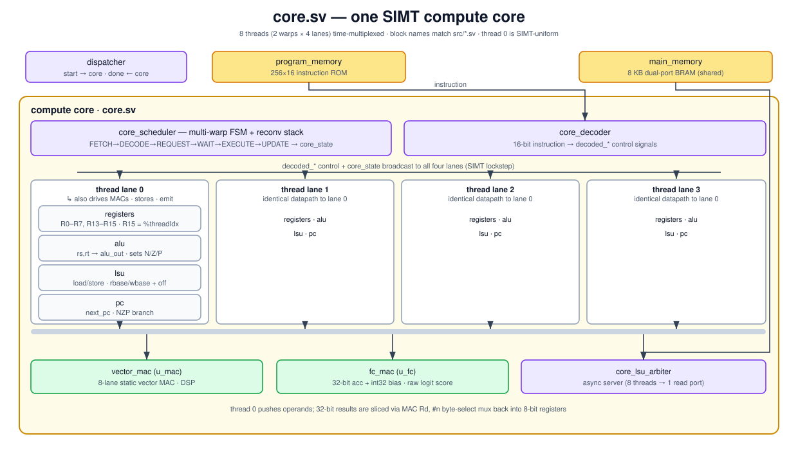
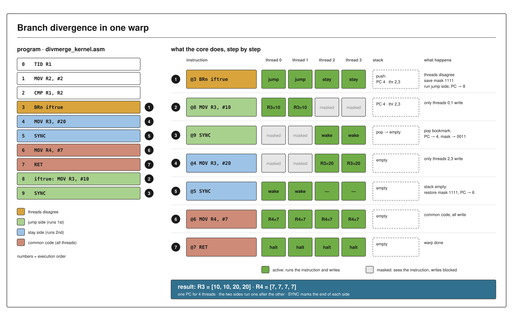
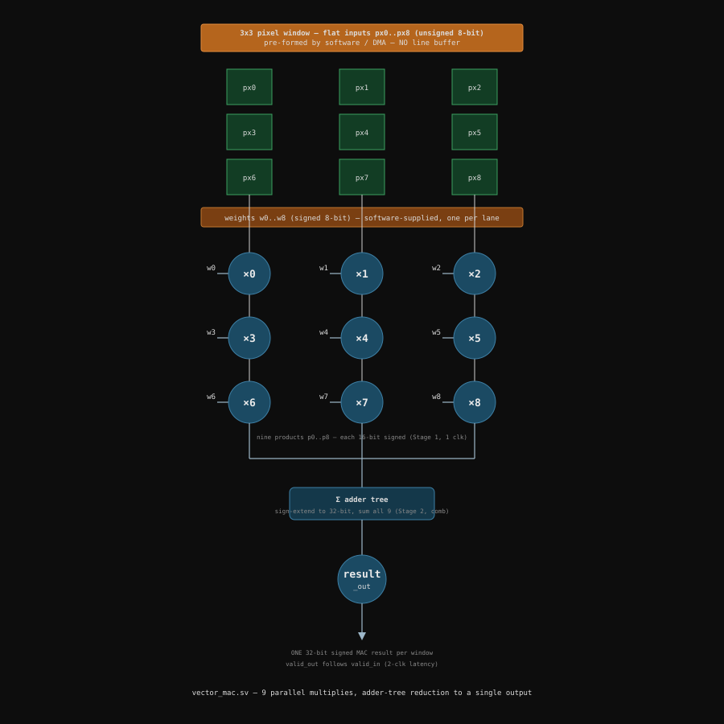
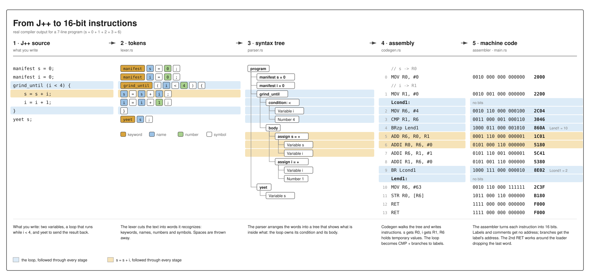

# tiny-gpu

A 16-bit SIMT GPU, built from scratch, running on a $30 FPGA.

Two compute cores. A warp scheduler that hides memory latency. A divergence stack so threads can take different branches and meet again. A language, J++, and a Rust compiler that lowers it onto the ISA. The board is a [Tang Nano 20K](https://wiki.sipeed.com/hardware/en/tang/tang-nano-20k/nano-20k.html). The clock is 81 MHz, from the 27 MHz crystal through an on-chip PLL. A handwritten digit goes in over UART. The chip sends the class back.

I built it to learn how a GPU actually works, by making a small one I could hold and imitating an Nvidia GPU as closely as a $30 part allows.

- 16-bit ISA and assembler
- J++, a small language, and its compiler
- Branch divergence and warp scheduling
- 2 compute cores
- MNIST inference at 81 MHz

The long version is [I Built a Custom AI GPU on a $25 FPGA](https://joseignacio.vercel.app/custom-ai-gpu). The thread this page follows is [on X](https://x.com/JoseIgnacioNar5/status/2075357471267234046).

The hardware is a descendant of Adam Majmudar's [tiny-gpu](https://github.com/adam-maj/tiny-gpu). The same kind of project, for a TPU, is Surya Sure's [tiny-tpu](https://github.com/tiny-tpu-v2/tiny-tpu). The board's first life was a fixed CNN, [cnn_chip](https://github.com/123-code/cnn_chip): a serial dot product turned into a parallel MAC array, INT8 weights, the whole MNIST forward pass on the chip.

## See it run

The two recordings from the thread.

**MNIST.** Draw a digit. The board on the desk classifies it.

https://github.com/user-attachments/assets/483893c5-2ad0-419e-acb1-64ace0cbf1e4

**J++.** Sum `0..7`. Both cores reply `28` (`0x1C`).

https://github.com/user-attachments/assets/e584bf2e-4f50-4bc3-861e-336ae5489037

That second clip is one command. It compiles the kernel, assembles it, streams the binary over UART, runs it on both cores, and prints what they send back.

```bash
make run-jpp JPP=software/demo.jpp READ=2
```

```jpp
// software/demo.jpp
manifest s = 0;
manifest i = 0;
grind_until (i < 8) {
    s = s + i;
    i = i + 1;
}
yeet s;
```

`make demo` serves the draw-a-digit page from the first clip at <http://localhost:8000>. `make run-mnist-jpp` classifies 50 MNIST test images on the board and checks them against the bit-exact reference. Both need a bitstream already loaded. The open-source flow below builds one.

The same language also drives a Wolfenstein-style raycaster, scanned out over HDMI: `make sim-raycast`, and `make run-raycast` once `oss_build/tiny_gpu_hdmi.fs` is on the board.

## The machine

[](docs/gpu_overview.svg)

Three layers. A host loads the work. A dispatcher hands it out. Two cores execute it as SIMT threads.

The board has no CPU. A UART receiver feeds a DMA engine, which reads a small header (program size, data size) and writes the kernel and its data into on-chip memory. When the payload is in, the DMA pulses `gpu_start`. An arming FSM holds the GPU in reset for a few cycles, then lets it run once. Bytes the kernel emits are arbitrated back onto the UART transmitter and mirrored on the LEDs. The computer is the host.

The dispatcher is one-shot. It gives block 0 to core 0 and block 1 to core 1, then waits until both report done. The number of cores is the number of blocks.

Each core has its own copy of the program ROM and its own data memory. The two program counters never share a BRAM port, so the cores run at the same time, each on its own instruction stream. A UART arbiter owns the one cable back to the host: core 0 sends its bytes, then core 1 sends.

[](docs/core_detail.svg)

A core is one warp scheduler in front of shared execution hardware.

- **Scheduler.** Owns the pipeline. With more than one warp, it picks who drives the pipeline each pass. A warp stalled on memory is `WARP_WAITING`. A warp that can run is `WARP_READY`. A warp that has halted is `WARP_DONE`.
- **Fetch and decode.** Read the 16-bit instruction at the current warp's PC and turn it into register addresses, an immediate, an ALU op, and the memory and branch flags.
- **Lanes.** Every thread in the warp has its own ALU, load/store unit, and register file, so one instruction operates on many threads' data. Three registers are read-only identity: thread id, block id, block size. That is how one kernel does different work per lane.

Every instruction walks the same nine states. `SELECT_WARP` runs after every instruction, which is where a stalled warp gets swapped out.

```
IDLE → SELECT_WARP → FETCH → DECODE → REQUEST → WAIT → EXECUTE → UPDATE → DONE
```

`REQUEST` and `WAIT` are the memory ops. `DONE` is the end of a warp.

### Branch divergence

[](docs/divergence.svg)

Threads in a warp share one program counter, so `if (x > 0)` cannot send them two ways in the same cycle. The warp carries an active mask. Four threads start as `1111`. A bit of `1` means that lane's result is written. A bit of `0` means the lane still executes, and its register and memory writes are dropped.

When the lanes disagree on a branch, the scheduler pushes a bookmark: the PC to come back to, and the mask of the lanes that did not take the branch. It then runs the taken side. `SYNC` pops the bookmark and runs the other side under the saved mask. A `SYNC` on an empty stack restores the mask from before the split, and the warp continues together. J++ `if` lowers to `CMP`, a branch, and these `SYNC`s.

### Memory

Program memory and data memory are separate, so a core can fetch an instruction and touch data in the same cycle. Program memory is 16 bits wide, one instruction per row. Data memory is 8 bits wide. The address bus is 13 bits, 8 KB, widened from the 8-bit space this design started from.

A single `LDR` is one instruction and many lanes, and the data RAM has one read port. The load/store arbiter freezes the warp, walks the lanes through that port one cycle at a time, then wakes the warp. Stores go through a second arbiter. Thread 0 is the lane that drives the shared MAC and the UART emit.

## How it got here

### A CNN, then a question

The Tang Nano arrived as a way to learn hardware from software. The first thing that ran on it was [cnn_chip](https://github.com/123-code/cnn_chip): MNIST, INT8, a MAC array instead of a serial dot product, weights and activations on the chip. Once that classified a digit, the next question was whether the same part could be a GPU, with a program counter, threads, and a language, instead of a network baked into the wiring.

### Four threads

The first GPU was one core and four threads, programmed in assembly. The kernel was a multiply. The point of that version was a warp that fetched, decoded, and executed, and a result that came back on the UART.

### A MAC array

[](docs/mac_array_actual.svg)

Matrix multiplies needed something faster than a loop of `MUL`s. Two instructions talk to the array. `MACL` pushes an operand pair from the core into the unit's register buffers. `MAC` dots those buffers. The sum is 32 bits, and the core reads it back one byte at a time.

The nine products are registered, then a combinational adder tree reduces them, then the 32-bit sum is registered on the way out. The register in front of the tree is there because the multiply-and-add path did not meet timing as one combinational cloud. `vector_mac` is a 3×3 window: nine unsigned pixels, nine signed weights, one signed 32-bit result, valid two cycles after valid-in.

### A second core, and warps that hide latency

The next machine has two cores. The dispatcher, the private memory, and the UART arbiter are what make them actually parallel. A shared program ROM would have serialized them on one read port.

A load takes several cycles, and a core that sits on that load is wasting the ALUs. After every instruction the scheduler returns to `SELECT_WARP`, looks at every warp, and picks the next one in `WARP_READY`. Warp A can be waiting on memory while warp B multiplies.

### A language

[](docs/jpp_pipeline.svg)

Assembly was enough to prove the core. It was the wrong way to write a convolution. J++ is a small C-like language, and the compiler is a Rust crate in `software/src` with the usual four stages.

The lexer cuts the text into tokens (`manifest`, a name, a number, an operator). The parser walks that list with a cursor. Each keyword has a parse function, and a statement that consumes what it expects becomes a `Stmt` in the abstract syntax tree. A token in the wrong place is a syntax error. Codegen walks the tree and emits assembly: a variable is a register, a loop is `CMP` and a branch, `yeet` is a store to the memory-mapped UART. The assembler looks up the opcode, packs the register fields and the immediate into a 16-bit word, and writes a `.hex` file. That file is what the DMA streams onto the FPGA.

```
.jpp  →  .asm  →  .hex  →  UART  →  GPU
```

### Kernels on the chip

`software/mnist.jpp` is the whole MNIST CNN in J++: a 3×3 convolution (28×28 to 26×26), a 2×2 max pool (to 13×13), a dense layer 169→10, then argmax. It compiles to 186 instructions. Convolution and pooling are split across lanes with `tid`, so on the 9-thread bitstream the run is 241k cycles, down from 1.04M when the same work is one pixel at a time. `make sim-mnist-jpp-full` checks the conv map, the pooled map, and the prediction against `software/mnist_ref.py`.

## Blackwell, in miniature

A B200 has ~148 SMs and 192 GB of HBM3e. None of that scale fits on a $30 FPGA. The mechanisms do, at small size: [docs/blackwell.md](docs/blackwell.md) has one section per feature, with the instructions that drive it and the test that proves it.

- **Grid scheduling.** A launch is `gridDim` blocks queued onto the cores as they free up, with the reply kept in blockIdx order.
- **Shared memory and `BAR`.** A 1 KB scratchpad per core and a block-wide barrier.
- **A tensor core with Tensor Memory.** An async 4x4 MMA that reads A and B from shared memory by address and accumulates in TMEM, not registers. Kinds: int8, FP8 (e4m3), FP4 (e2m1), and MXFP4 with E8M0 block scales, all bit-exact against a Python model.
- **TMA.** A copy engine that streams operand tiles into shared memory while the previous MMA runs.
- **Global memory.** The in-package 64 Mbit SDRAM, shared by both cores and the host, with a controller, a per-core L1, `LDG`/`STG`, and TMA from global.
- **Clusters.** The two cores as a pair: distributed shared memory, a cluster barrier, and a 2-SM MMA with B split across the cores.
- **Pipelined issue.** ALU code runs at 1.77 cycles per instruction instead of 6: the next instruction decodes while the current one executes and the one before writes back.
- **An on-chip host CPU.** An RV32I core running C firmware that loads, launches, and checks GPU kernels through the shared SDRAM. Grace, at this scale.
- **A board-to-board link.** Two wires, remote global stores, and an all-reduce across two simulated boards. NVLink, at this scale.

- **The compiler uses the tensor core.** `graph_compiler --tc` lowers every Linear to TMA + MMA + TLDQ: the trained MLP runs 32x faster, bit-identical.

All of it is simulated and self-checking (`make regress`). It does not all fit on the chip at once: `oss_build/build_board.sh` builds a board subset (2 cores x 4 lanes with the tensor core, TMA, shared memory and clusters) that places and routes at 78% of the LUTs; timing and details in [board fit](docs/blackwell.md#board-fit)). None of it has run on hardware yet.

## Instruction set

Every instruction is 16 bits. `[15:12]` is the opcode, `[11:9]` is `rd`, `[8:6]` is `rs`, `[5:0]` is the immediate. The third register, `rt`, lives in `[2:0]`.

| Opcode | Mnemonic | What it does |
| --- | --- | --- |
| `0000` | `FRST` / `FMAC` / `FARG` / `FBEST` | FC-MAC coprocessor, sub-function in `[5:4]`. Reset. `acc += rs*rt`. Finalize a digit (add the int32 bias, latch the logit). Read the logit LSB. |
| `0001` | `ADD rd, rs, rt` | `rd = rs + rt` |
| `0010` | `MOV rd, #imm` | `rd = imm`, a 6-bit immediate |
| `0010` | `TID` / `BID` / `BDIM rd` | `MOV` with `rs` nonzero. `rd` becomes threadIdx (R15), blockIdx (R13), or blockDim (R14). |
| `0011` | `CMP rs, rt` | Set N, Z, P. Negative, zero, positive. |
| `0100` | `LDR rd, [rs]` | `rd = mem[rbase + rs]` |
| `0101` | `ADDI rd, rs, #imm` | `rd = rs + imm` |
| `0110` | `MACL rs` | Push an operand pair into the vector MAC buffer. |
| `0111` | `MAC rd, #n` | Fire the vector MAC. Byte `n` of the 32-bit sum lands in `rd`. |
| `1000` | `BRn target` | Branch if N. 8-bit target. On divergence, push the mask. |
| `1001` | `ADDB #imm` / `WBASE #imm` | Advance the read base, or the write base. Bit `[11]` selects. |
| `1010` | `MUL rd, rs, rt` | `rd = rs · rt` |
| `1011` | `STR rt, [rs]` | `mem[wbase + rs] = rt`. `rs == 63` is the UART transmit. |
| `1100` / `1101` / `1110` | `SHR` / `SHL` / `SUB` | Shift right, shift left, subtract. |
| `1111` | `RET` | Halt the warp. |
| `1111` | `SYNC` | Pop the divergence stack and swap in the saved mask. Bit `[0]` set. |
| pseudo | `MAX rd, ra, rb` | `CMP`, `BRn`, `ADDI`. The assembler expands it. |

R0–R7 are the registers an instruction can name. The fields are 3 bits. R13, R14, and R15 are the SIMT identity registers, copied into R0–R7 by `BID`, `BDIM`, and `TID`.

The Blackwell features added more, all in fields their host instructions left unused, so the opcode count is still 16:

| Mnemonic | Lives in | What it does |
| --- | --- | --- |
| `GDIM` / `CRANK rd` | `MOV`, `rs` = 5 / 6 | gridDim / rank in a cluster pair |
| `LDS` / `STS` | `LDR` bit 5 / `STR` rd = 1 | shared-memory halfword |
| `LDG` / `STG` | `LDR` bit 4 / `STR` rd = 2 | global-memory halfword, through the L1 |
| `BAR` / `CBAR` | `RET` bit 1 / bit 3 | block barrier / cluster barrier |
| `MMA` / `MMA2` / `TCFG` | `MACL` rd = 1 / 3 / 2 | tensor-core MMA / 2-SM MMA / kind + readout shift |
| `TLD` / `TLDQ` | `MAC` rs = 1 / 2 | TMEM row to a register / requantized to 0..255 |
| `TMA` / `TMAG` / `TMAWAIT` | `ADDB` rd = 010 / 011, `RET` bit 2 | bulk copy to shared memory, from data / global memory; wait |

`WBASE` is `ADDB` with bit 11 set, and `SYNC` is `RET` with bit 0 set. The decoder splits them, so the ISA grew without spending a new opcode. Upstream tiny-gpu had 11 instructions. The MAC and FC ops, the shifts, the base pointers, and `SYNC` are what let a dot product and a divergent `if` fit in a program this small.

## J++

The compiler is `software/src`: `lexer.rs`, `parser.rs`, `codegen.rs`, and the assembler in `main.rs`.

| You write | The hardware does |
| --- | --- |
| `manifest x = …` | A variable. Register-allocated. |
| `grind_until (cond) { … }` | A loop. `CMP` and a branch. |
| `yeet expr` | Emit a byte. Store to the UART address. |
| `tid` / `bid` / `bdim` / `gdim` | This lane's thread, block, block size, and grid size. |
| `crunch_push` / `crunch_fire x, n` | `MACL`, then `MAC`. `n` picks byte 0–3 of the 32-bit sum. |
| `*`, `<<`, `>>`, parentheses | `MUL`, `SHL`, `SHR` on each lane's ALU. |
| `if (cond) { … }` | `CMP`, a branch, `SYNC`. Lanes may disagree. |
| `max(a, b)` | The larger value. Safe when lanes disagree. |
| `advance n` / `wbase n` | Move the data-memory read base or write base. |
| a number above 63 | `LDI`. The assembler builds the full 16-bit constant, up to 65535. |

Two limits come straight from the stack. An `if` or a `max` inside another `if` body would emit a `SYNC` that wakes lanes the outer `if` had masked, so the compiler rejects it. A `grind_until` does not emit `SYNC`, so the loop condition has to be the same on every lane.

```bash
cd software
cargo run --bin jpp -- program.jpp program.asm
cargo run -- program.asm
```

## Simulate

Icarus Verilog. Every target checks its own result and fails if the hardware is wrong.

```bash
make sim                # 5 * 3 = 15
make sim-loadrun        # stream a kernel and its data over UART, run, check the reply
make sim-divergence     # lanes take different branches
make sim-divmerge       # they meet again, and the shared code runs on every lane
make sim-warps          # two warps, eight lanes, thread ids 0..7
make sim-mac32          # the 32-bit MAC sum comes back one byte at a time
make sim-mlp            # nine lanes, nine neurons, each lane writes its own
make sim-jpp-features   # if, max, and constants above 63, with lanes that disagree
make sim-mnist-jpp-full # the whole CNN: conv map, pooled map, prediction
make sim-raycast        # two raycaster frames, every column against the reference
```

Each one is the smallest proof that one piece of the machine works: divergence, warp ids, the MAC path, the compiler.

The Blackwell features each have their own target too (`sim-grid`, `sim-smem`, `sim-mma-all`, `sim-tma`, `sim-sdram`, `sim-global`, `sim-cluster`, `sim-cpi`, `sim-drain`, `sim-host`, `sim-link`; see [docs/blackwell.md](docs/blackwell.md)). Two targets run everything:

```bash
make regress        # every fast self-checking testbench, a few minutes
make regress-full   # plus the slow end-to-end sims and a 20-model fuzz
```

## Build and flash

Both flows target the Tang Nano 20K, a Gowin GW2AR-18. The open-source flow is the one that produces the bitstreams this repo runs. Gowin's `GowinSynthesis` segfaults on the multi-warp design.

```bash
export OSS_CAD_SUITE=/path/to/oss-cad-suite   # YosysHQ/oss-cad-suite-build
make build-oss        # oss_build/tiny_gpu_oss.fs
make flash-oss        # SRAM. Gone on power cycle.
```

The largest configuration used for inference is 2 cores × 1 warp × 9 lanes, 18 ALU lanes, about 78% of the LUTs, timing closed around 140 MHz.

```bash
make build-oss-max    # oss_build/tiny_gpu_max18.fs
make flash-oss-max
```

The vendor flow is still wired for the single-warp configuration.

```bash
make build            # impl/pnr/tiny_gpu.fs
make flash            # SRAM
make flash-persist    # SPI flash, boots on its own
```

With a bitstream loaded, source to result is the command from the clip.

```bash
make run-jpp JPP=software/your_kernel.jpp READ=8
```

You need Rust (`cargo`) for the assembler and the compiler, Icarus Verilog (`iverilog`, `vvp`) to simulate, [oss-cad-suite](https://github.com/YosysHQ/oss-cad-suite-build) (Yosys, nextpnr-himbaechel, apicula, openFPGALoader) to synthesize and flash, and Python 3 for `software/send_kernel.py`.

## Silicon

Vendor place-and-route for the smaller configuration, from `impl/pnr/tiny_gpu.rpt.html`.

| Resource | Used | Available | |
| --- | --- | --- | --- |
| Logic | 1501 (1052 LUT4, 449 ALU) | 20736 | 8% |
| Registers | 878 | 15750 | 6% |
| Slices | 1180 | 10368 | 12% |
| Block SRAM | 4 SDPB + 1 pROM | 46 | 11% |
| DSP | 4× MULT9X9 + 5× MULTADDALU18X18 | | |
| I/O | 9 | 66 | 14% |

The design is clocked at 81 MHz, the 27 MHz crystal multiplied by 3. The 18-lane configuration closes timing around 140 MHz and uses about 78% of the LUTs.

## Repository

```
src/        gpu, core, scheduler, dispatcher, decoder, registers, alu, pc,
            lsu, lsu_arbiter, lsu_write_arbiter, vector_mac, fc_mac,
            main_memory, program_memory, dma_controller, data_pipeline,
            uart_rx, uart_tx, hdmi, gowin_pll, top
            + shared_memory, tensor_core, copy_engine, l1_cache, mem_arb,
            sdram_ctrl, host_cpu, board_link   (docs/blackwell.md)
software/   Rust crate. Assembler in src/main.rs, J++ in src/bin/jpp.rs.
            Kernels (*.jpp, *.asm). UART host scripts. MNIST weights.
test/       Self-checking testbenches. sdram_model.sv checks the SDRAM protocol.
demo/       Draw-a-digit page.  make demo
docs/       Diagrams, and the two recordings in docs/videos/
oss_build/  Yosys + nextpnr flow.
drills/     Six small Verilog exercises, with solutions.
```
